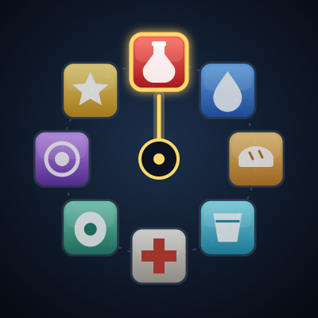

# ForeverRings



Radial action rings for World of Warcraft: Forever. Hold a key, a ring
of icons opens around the cursor, point at one and let go to use it.
Rings fill themselves from your bags and spellbook, so a new potion or
a new rank of a buff turns up without you touching anything.

Inspired by [OPie](https://www.townlong-yak.com/addons/opie) and
AutoBar. It shares no code with either and is not affiliated with
their authors.

## Installing

Copy this folder into the Forever client's AddOns folder, keeping the
name `ForeverRings`:

```
World of Warcraft/_forever_/Interface/AddOns/ForeverRings
```

The TOC targets interface `16001`.

## Using it

1. Type `/frings` to open the options window.
2. Pick a ring, click the **Key** button and press the key you want.
3. In game, hold that key, aim at a slice and release.

Releasing near the centre of the ring cancels. Hovering a slice shows
its tooltip, and cooldowns show as a swipe with the seconds left.

Rings work in combat. Their *contents* only change out of combat: if
you use up an item mid-fight its slice greys out, and the ring catches
up when combat ends.

`/rl` reloads the UI, unless another addon has already claimed it.

## Rings

A fresh install comes with five unbound rings:

| Ring        | Holds                                                             |
|-------------|-------------------------------------------------------------------|
| Consumables | Healing potion, mana potion, other potions, elixirs & flasks, food, drink, bandage |
| Travel      | Hearthstone, teleports, portals                                   |
| Buffs       | Class buffs, conjured food and water included                     |
| Quest       | Quest items you can use                                           |
| Mounts      | Random favourite mount, then each favourite                       |

A ring is an ordered list of slots. Each slot is either:

- a **category**, which fills itself, or
- a **fixed** spell, item or macro, dragged in from the spellbook, bags
  or macro window.

A ring shows its first 12 actions in slot order. Change the order with
the Up and Down buttons in the options window.

### Categories

| Category           | Slices        | Picks                                         |
|--------------------|---------------|-----------------------------------------------|
| Healing Potion     | one, best     | Potions that cast "Healing Potion"            |
| Mana Potion        | one, best     | Potions that cast "Restore Mana"              |
| Other Potions      | one per item  | Every other potion                            |
| Elixirs & Flasks   | one per item  | Elixirs and flasks                            |
| Food               | one, best     | Food & drink items that don't cast "Drink"    |
| Drink              | one, best     | Items that cast "Drink"                       |
| Bandage            | one, best     | Bandages                                      |
| Usable Quest Items | one per item  | Quest items with a use effect                 |
| Hearthstone        | one           | The Hearthstone, or the Hearths macro (below) |
| Teleports          | one per spell | Mage teleports, Moonglade, Astral Recall, Death Gate |
| Portals            | one per spell | Mage portals                                  |
| Class Buffs        | one per spell | Buffs, armours, aspects, blessings, conjuring |
| Random Favourite Mount | one       | The mount journal's random favourite          |
| Favourite Mounts   | one per mount | Collected favourites, by name                 |

If the [Hearths](https://github.com/alde/hearths) addon is loaded, the
Hearthstone slot uses its `HEARTHS_BTN` macro instead, so the ring
rotates hearthstones along with it.

Mounts come from the mount journal. A mount you can't use where you
are still shows, rather than the ring emptying every time you go
indoors.

"Best" means highest item level, then newest item. Items above your
level are skipped. Spells cast by name, so you always get the highest
rank you know.

Items are sorted by item class, subclass and the name of the spell
they cast on use. There are no hand-kept item lists to go stale. The
spell categories do use lists of spell IDs, in
[`SpellLists.lua`](SpellLists.lua). They are classic-era IDs and not
all have been checked in game, so if a spell you know is missing, its
ID is the first suspect.

## Options

`/frings` and the AddOns compartment button open a movable window. The
same controls appear under **Options → AddOns → ForeverRings**, but the
Settings panel takes over the keyboard and blocks bags and the
spellbook, so drag-and-drop only works in the window. The Settings page
has a button to open it.

The window covers:

- **Spawn animation**: none, fade in, grow, unfold from centre or
  spiral out, at 0.05–0.5 seconds.
- **Rings**: create, delete and pick a ring to edit.
- **Key**: click, then press a key with any modifiers. Right-click
  clears it.
- **Contents**: add a category, drop in a spell, item or macro, and
  reorder or remove slots.

## How it works

Each ring is a protected frame plus a hidden secure action button that
the key binding clicks. Key down shows the ring at the cursor; key up
works out which slice the cursor points at and sets the button's
action to it before the click goes through. Both steps run in the
game's restricted environment, which is what lets rings work in combat.

That slice choice is written twice: once in the restricted snippet in
[`Ring.lua`](Ring.lua), and once in
[`Layout.lua`](Layout.lua) for the hover highlight, because restricted
code cannot call ordinary addon functions. A test runs both all the way
round the ring to keep them in agreement.

| File              | Does                                                      |
|-------------------|-----------------------------------------------------------|
| `SpellLists.lua`  | Spell IDs for the spell categories                        |
| `Categories.lua`  | Category definitions                                      |
| `Actions.lua`     | Turns a ring's slots into slices (pure)                   |
| `Layout.lua`      | Slice directions and hit-testing (pure)                   |
| `Animation.lua`   | Spawn animation poses (pure)                              |
| `Context.lua`     | Reads bags, spells, macros and mounts for `Actions.lua`   |
| `Cooldowns.lua`   | Puts item, spell and macro cooldowns on a slice           |
| `Config.lua`      | Saved settings, migrations and every change to them       |
| `Ring.lua`        | The ring frames, secure snippet, tooltip and animation    |
| `Core.lua`        | Events, ring registry and the out-of-combat queue         |
| `Commands.lua`    | `/frings` and `/rl`                                       |
| `Options.lua`     | The options window and Settings page                      |

Saved settings live in `ForeverRingsDB` and are upgraded through
numbered migrations in `Config.lua`, so an upgrade never brings back a
default ring you deleted.

## Tests

The pure modules, the secure snippet, the settings migrations and the
cooldown routing are tested outside the game with LuaJIT:

```bash
luajit tests/run.lua
```

Anything that needs real frames (the panel layout, key capture, combat
behaviour) still has to be checked in game.

